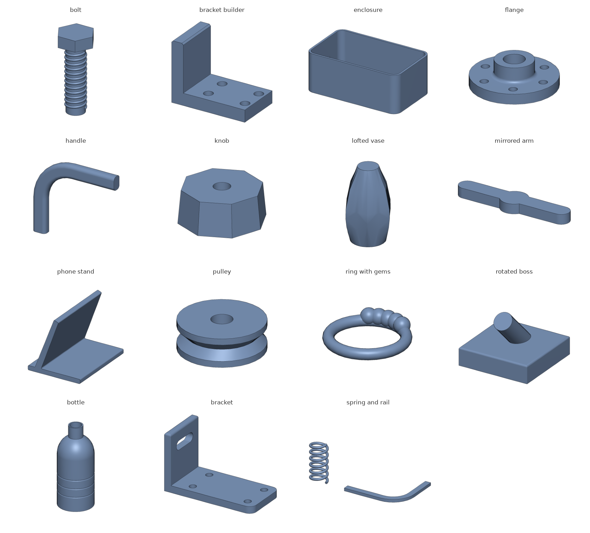

# keel

A small CAD language on NVIDIA's [usd-brep](https://github.com/NVIDIA-Omniverse/usd-brep) kernel (SMLib).
You describe parts in Python, with 1D paths, 2D sketches and 3D parts. The output is exact
B-rep geometry stored natively in USD (`BrepArray` prims), plus STL/OBJ meshes.



```python
from keel import *

plate = Box(60, 40, 6, align=("center", "center", "min"))
plate -= Cylinder(3, 6, align=("center", "center", "min")).at(grid(2, 2, 46, 26))
boss  = Circle(10).on(plate.faces(">Z")).extrude(8)
part  = (plate + boss).fillet(">Z and %circle", 1)

part.named("plate", color=(0.7, 0.7, 0.75)).export("plate.usda")
part.export("plate.stl")
```

## Running it

NVIDIA publishes the kernel for Linux and Windows only, but it builds natively on a Mac
from their source. One command builds it (about 1.5 minutes, plus about 15 for OpenUSD the first time):

```bash
native/build.sh --build-usd      # kernel + Python module + USD support, native on macOS
bin/keel examples/bracket.py     # run a script; output files land in your directory
bin/keel -m pytest tests         # run the tests
```

`native/build.sh` compiles NVIDIA's unmodified source (SMLib, SM_API, their USD layer and
their Python bindings) with a small CMake file, against OpenUSD 25.11, the version they ship.
Leave out `--build-usd` for a modeling-only build. Everything except USD files works without it.

`bin/keel` runs natively when that build exists. Otherwise it runs NVIDIA's Linux wheel in
Docker (`docker/Dockerfile`). `KEEL_DOCKER=1` forces Docker. On Linux or Windows,
`pip install usd-brep` works too.

Mac-built and Linux-built files read each other: same faces, volumes within 1e-5, all valid.

## The language

keel combines two styles. **Values with operators** come from build123d's algebra
mode: shapes are immutable, and `+ - &` combine them. **Compact selector strings** come
from CadQuery: `">Z"`, `"|Z"`. A `with Build()` block is there if you prefer to
accumulate a part step by step.

### 3D: parts

| | |
|---|---|
| Primitives | `Box(l, w, h)`, `Cylinder(r, h)`, `Cone(r0, r1, h)`, `Sphere(r)`, `Torus(R, r)`. They are centered unless `align="min"`/`"max"` or a per-axis tuple says otherwise. |
| Booleans | `a + b` fuse, `a - b` cut, `a & b` intersect. The right side can be a list: `plate - holes`. `sum(parts)` fuses them all. |
| Placement | `.move(x, y, z)`, `.rotate("Z", 45, about=(0,0,0))`, `.mirror("YZ")`, `.scale(2)`, `.place(plane)`, `.at(grid(...))` (copies) |
| Features | `.fillet(edges, r)`, `.chamfer(edges, d)`, `.shell(t, open=faces)`, `.offset(d)` |
| Measures | `.volume`, `.area`, `.center`, `.bbox` (`.min .max .size .center`), `.is_valid` |

Edge selections leave out seams, the lines where a cylinder or sphere wraps onto itself, because they can't be filleted. Use `edges(seams=True)` to include them.

Operations never change the part you call them on. The kernel mutates and consumes its
inputs, so keel always hands it private copies.

### Selecting faces and edges

`part.faces(...)`, `part.edges(...)` and `part.vertices(...)` return a `Selection`, which is a list. Narrow it
with a selector string or methods:

| String | Method | Meaning |
|---|---|---|
| `">Z"` / `"<X"` | `.max("Z")` / `.min("X")` | furthest along an axis (ties kept) |
| `"\|Z"` | `.parallel("Z")` | straight edges, or planar-face normals, parallel to the axis |
| `"#Z"` | `.perpendicular("Z")` | perpendicular to the axis |
| `"+Z"` / `"-X"` | `.facing("Z")` | faces whose outward normal points that way |
| `"%line"` `"%circle"` `"%plane"` `"%curved"` | `.of_type(...)` | by geometry |
| `"\|Z and >X"` | chained calls | combine |

Other methods: `.sort("Z")`, `.near(point)`, `.largest()`, `.smallest()`, `.filter(fn)`,
`.edges()` (edges of the selected faces), `.first`, `.last`, `.one()`. Feature
methods accept either form: `part.fillet("|Z", 2)` or `part.fillet(part.edges("|Z").max("X"), 2)`.

### 2D: sketches

Sketches are planar regions, including holes, drawn in a plane's local XY.

| | |
|---|---|
| Shapes | `Rect(w, h)`, `Circle(r)`, `Ellipse(rx, ry)`, `RegularPolygon(r, n)`, `Polygon(*pts)`, `Slot(length, width)`, `RoundedRect(w, h, r)`, all centered |
| Booleans | `+ - & ^` |
| Placement | `.move(x, y)`, `.rotate(deg)`, `.mirror("Y")`, `.scale(f)`, `.at([(x, y), ...])`, `.on(target, x=, y=, rotation=)` |
| To 3D | `.extrude(d, both=False, taper=0)`, `.revolve(deg, axis="Y")`, `.sweep(path)`, `loft(s1, s2, ...)` |

`.on(...)` takes a `Plane`, a plane name (`"XY"`, `"XZ"`, `"YZ"`, ...), a planar `Face`, or
a one-face selection. That makes `Rect(6, 6).on(part.faces(">Z")).extrude(-2)` a pocket.
Planes: `Plane.at(origin, normal)`, `.offset(d)`, `.shifted(x, y)`, `.rotated(deg)`, `.flipped()`.

### 1D: paths

| | |
|---|---|
| Segments | `Line(a, b)`, `Polyline(*pts, close=)`, `Arc(center, r, start°, end°)`, `ThreePointArc(p0, p1, p2)`, `Spline(*pts)`, `Helix(r, height, turns)` |
| Drawing | `Pen(x, y).line_to(..).line(dx, dy).h(dx).v(dy).arc_to(x, y, through=).tangent_arc_to(x, y).spline_to(..)`, then `.close()` or `.path` |
| Use | `path + path`, `.close()`, `.to_sketch()`, `.pipe(r)`, `.sweep(sketch)`, `.on(plane)` |

**Sweeps.** The profile stands perpendicular to the path at its start, and its center
follows the path. On non-planar paths (helices, 3D splines), round profiles are exact
pipes. For other profiles the kernel anchors the profile's first boundary point on the
path, and keel warns when that happens.

### Builder mode

```python
with Build() as b:
    b += Box(40, 20, 5)
    b -= Cylinder(3, 5).at(grid(2, 1, 25, 0))
    b.fillet("|Z", 2)
part = b.part
```

### Patterns

`grid(nx, ny, dx, dy)`, `polar(count, radius, start=, sweep=)` and `line_of(count, spacing, dir)`
return location lists for `.at(...)`.

## keel123d: build123d's language

`keel123d` is build123d's API on the same kernel. A build123d script runs on NVIDIA's
kernel by changing its import:

```python
import keel123d as bd              # instead of: import build123d as bd

with bd.BuildPart() as flange:
    bd.Cylinder(40, 10)
    with bd.Locations(*bd.PolarLocations(30, 6)):
        bd.Cylinder(3, 10, mode=bd.Mode.SUBTRACT)
part = bd.fillet(flange.part.edges().filter_by(bd.GeomType.CIRCLE), radius=1)
bd.export_step(part, "flange.step")
```

It follows build123d 0.11's conventions (rotation order, alignment, workplanes, which
side an arc bulges to), checked against real build123d. It covers the builders
(`BuildPart`, `BuildSketch`, `BuildLine`), algebra mode, locations, the common primitives,
line objects, `extrude`/`revolve`/`loft`/`sweep`, `fillet`/`chamfer`/`mirror` and
`ShapeList` selection. Anything else raises `AttributeError` or `KeelError`: nothing is
silently approximated. Code that imports OpenCASCADE directly (`OCP`) can't run here.

`compat/t2c_harness.py` runs whole text-to-cad projects through both libraries and
`compat/compare.py` diffs volumes and bounding boxes. `from keel import build123d` is the
old name and still works.

## Files

| | |
|---|---|
| `export(parts, "x.usda")` / `part.export(...)` | Exact B-rep, one `BrepArray` prim per part under `/World`. In `.usda` files, prims are named from part labels, get `displayColor` from part colors, and the stage is marked mm and Z-up. `.usdc` keeps the geometry but uses the kernel's default prim names. |
| `.step` / `.stp` | Exact B-rep as AP214 STEP, one part per file, product named from the part label. Lines and circles are written as true `LINE`/`CIRCLE`. No OpenCASCADE needed. |
| `.stl` / `.obj` | Tessellated mesh |
| `export_mesh_usd(parts, "x.usda")` | `UsdGeom.Mesh` copy, for viewers without the BrepArray plugin |
| `load("x.usda")` | Back to Parts. Labels are restored from `.usda` prim names. |

Files are written by NVIDIA's own exporter, so anything that reads usd-brep's schema
(their Python API, their Hydra plugin for usdview) reads keel output.

**STEP and face names.** keel writes STEP itself from the kernel's exact USD record (the kernel
has no STEP writer). Tools like text-to-cad name faces and edges by position (`label.f12`,
`label.e7`), in the order OpenCASCADE reads them. keel writes faces in an order that reader
keeps, so `part.faces()[i]` is `f{i+1}`. For anything else use `part.ref(face_or_edge)` (gives
`"f12"`, or `"label.f12"` on a labeled part) and `part.find("e7")` (also takes `"#label.e7"`):
they follow the same plan the writer does, including the zero-length edges OpenCASCADE adds at
sphere poles and collapsed NURBS sides (`find` raises for those).

## Kernel notes

- Booleans, fillets and shells are SMLib's. When one fails, keel raises `KeelError` naming the operation.
- **Silent bad booleans are caught.** keel checks every boolean result: a fuse must contain both
  parts, and a cut or intersect can't add volume. The kernel can silently drop a part when a
  mirrored copy shares partly-trimmed faces with the original (e.g. `arm + arm.mirror("YZ")`
  where both include the same hub). keel raises instead. Build such shapes with `rotate`, or
  overlap them slightly. Reported upstream with a minimal reproduction
  ([image](docs/images/mirror_union_bug.png)).
- `Part.volume` and `Sketch.area` are measured to ~1e-6. The kernel's quick `volume()` can be
  0.1–0.7% off. `Part.area` is ~1e-4, the kernel's finest. `Part.bbox` is the tight box of the
  trimmed geometry.
- Lofts line up sections before skinning: polygon loops start at the corner nearest the first section's start, and circles are split into exact arcs at the polygon's corner angles, so circle → polygon → circle doesn't twist.
- Not available yet: text, STEP import, and per-edge variable fillets.
- Splines through two or three points are the line or quadratic through them, as in OpenCASCADE (the kernel's interpolator needs four).

## Testing

`bin/keel -m pytest tests` runs the unit tests, checked against analytic volumes to 1e-4.
The STEP tests read every file back with OpenCASCADE, so they need a Python with OCP: they use
`.venv-ref` (build123d's venv) or `KEEL_OCCT_PYTHON`, and skip without it. `tests/test_step_t2c.py`
also exports 17 of text-to-cad's example parts when a checkout is at
`.ref/t2c-feasibility/t2c-main` (or `KEEL_T2C_EXAMPLES`).
`cd gallery && ../bin/keel gallery.py` builds 12 realistic parts, checks each is valid and
survives a USD round trip, and writes STL/USD. `render.py` there draws them all into
`gallery/out/gallery.png`, using a small z-buffer renderer with smooth shading and edge outlines.

## Layout

```
src/keel/      _kernel (kernel access), geom (Plane/Axis), topo (Face/Edge/Selection),
               part (Part), sketch (2D), path (1D), solids (primitives), io, build, patterns
src/keel123d/  build123d's API on keel
compat/        run text-to-cad projects on build123d and keel123d, and compare
tests/         pytest suite (bin/keel -m pytest tests)
examples/      bracket.py, bottle.py
gallery/       realistic-part regression run + renderer
native/        build.sh + CMake for a native kernel build (macOS)
docker/        the Linux kernel image
```
